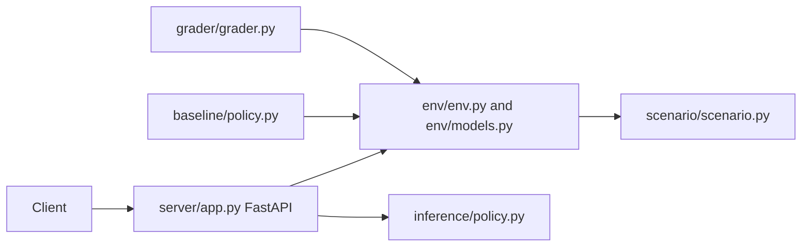

# RecallTrace OpenEnv

A deterministic Python 3.12 OpenEnv environment for supply-chain recall tracing and precision containment. It provides an environment model, scenario, baseline policy, grader, and FastAPI server suitable for evaluation workflows.

## Architecture



The environment is designed for deterministic state transitions. `scenario/` defines recall data and tasks, `env/` defines the state/action model, `baseline/` supplies a reference policy, and `grader/` scores outcomes.

## Setup

```bash
python -m venv .venv && . .venv/bin/activate
pip install -r requirements.txt
pytest
uvicorn server.app:app --host 0.0.0.0 --port 7860
```

The package also exposes a `server` entry point. Docker uses Python 3.12, installs `requirements.txt`, and starts Uvicorn on port `7860`.

## API and evaluation flow

Clients call the FastAPI server to create/interact with an environment. Actions are applied to typed state, policies produce decisions, and the grader evaluates recall-traceability and containment behavior. `inference/` isolates model-backed policy logic; API keys belong in deployment secrets.

## Testing and limitations

`tests/test_env.py` covers environment behavior. Add scenario, grader, API contract, and malformed-action tests when extending the environment. The deterministic model is an evaluation harness, not a production recall-management system; validate domain rules and data provenance separately.

## Security and operations

- Keep credentials, database URLs, OAuth tokens, API keys, and signing secrets in environment variables; never commit them.
- Validate and constrain uploaded files and user input at the server boundary, and enable HTTPS in production.
- Review dependency updates and rotate any credential that has appeared in repository history.

## Testing

The repository currently has no comprehensive automated test suite unless noted above. Before production changes, add tests for authentication/authorization, validation failures, persistence errors, and the primary user workflow.

## Limitations and roadmap

This is an actively evolving project. Production hardening, observability, rate limiting, backup/retention policy, and accessibility/performance validation should be completed before handling sensitive or high-volume workloads.

## License

See the repository license file and package metadata for the authoritative terms.
